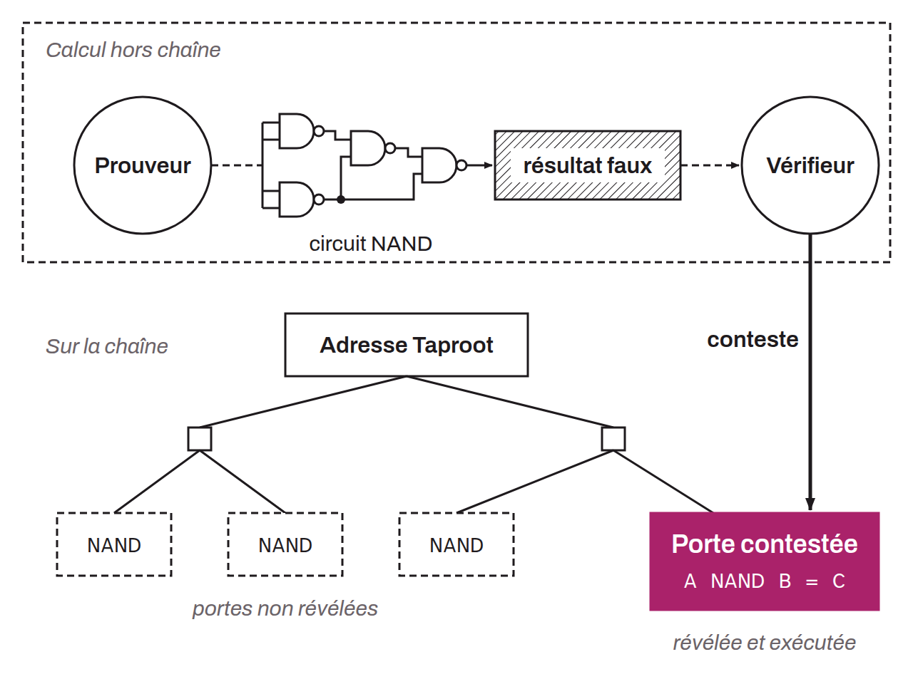

Protocole introduit par Robin Linus en 2023, qui vise à étendre les capacités de développement applicatif de Bitcoin. BitVM permet de vérifier sur Bitcoin n'importe quel calcul, exécuté hors chaîne, et d'utiliser son résultat pour diriger les bitcoins engagés. Bitcoin n'exécute donc pas le calcul : le protocole déplace tous les calculs en dehors de la chaîne tout en permettant de contester le calcul sur la chaîne si l'autre partie prétend à un résultat frauduleux. BitVM procure ainsi à Bitcoin une capacité de calcul quasi Turing-complet, et ce, sans requérir aucune modification au niveau du consensus. BitVM reproduit le comportement d'une porte logique `NAND` grâce à une utilisation conjointe des opcodes `OP_BOOLAND` (qui reproduit lui-même le comportement d'une porte logique `AND`) et `OP_NOT` (qui reproduit le comportement d'une porte logique `NOT`). Justement, cette porte logique `NAND` peut être utilisée à la chaîne pour reproduire le comportement de toutes les autres portes logiques existantes. C'est ce que l'on appelle une « porte universelle ». Par extension, une suite de portes logiques `NAND` peut donc reproduire n'importe quel circuit de calcul. L'idée avec BitVM est d'engager ce circuit dans une adresse Taproot, avec une feuille du MAST par porte `NAND`.

