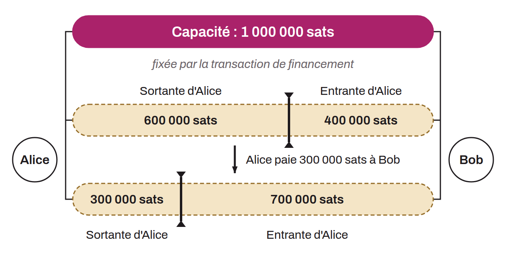

Quantité de bitcoins bloqués sur une adresse multisignatures qui représente un canal de paiement sur le Lightning Network. La capacité d'un canal est donc la quantité totale de sats engagés dans ce canal spécifique. La part réellement transmissible est plus faible : chaque partie doit conserver une réserve de canal (`channel_reserve_satoshis`), et celle qui a ouvert le canal paie les frais de la transaction d'engagement. La capacité est définie au moment de la création du canal par la somme des fonds que les parties engagent dans le canal, et elle peut ensuite changer par un *splice*. L'« *inbound capacity* », ou « capacité entrante », désigne la quantité maximale de bitcoins qu'un nœud peut recevoir via un canal. L'« *outbound capacity* », ou « capacité sortante » représente la quantité maximale de bitcoins qu'un nœud peut envoyer à travers un canal spécifique.

