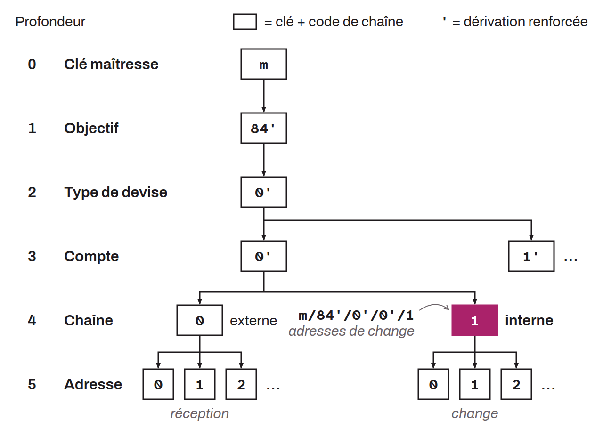

Dans la dérivation des portefeuilles déterministes et hiérarchiques, la chaîne interne est une branche de dérivation utilisée pour générer des adresses que le portefeuille n'a pas à communiquer à des tiers, en pratique les adresses de change. Chaque compte tel que défini en profondeur 3 dispose de deux chaînes en profondeur 4 : une chaîne externe et une chaîne interne (également appelée « change »). La chaîne interne est dérivée avec un index de `/1/`.

