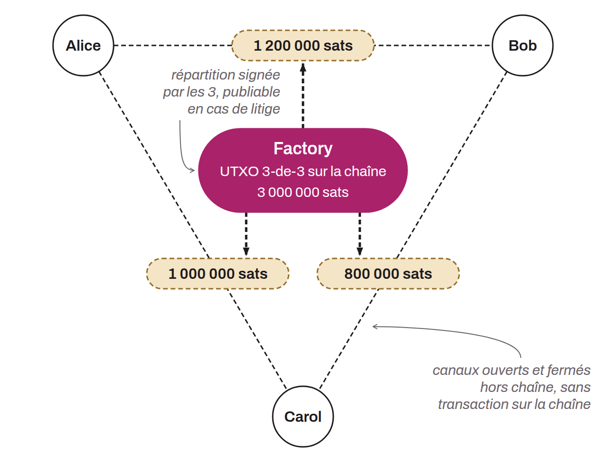

Mécanisme avancé en cours de travail sur Lightning, permettant la création et la gestion de plusieurs canaux de paiement à partir d'un seul UTXO. Les channel factories utilisent des adresses multisig `n-of-n` pour qu'un groupe d'utilisateurs puisse détenir collectivement un seul UTXO. De là, ils peuvent ouvrir et fermer des canaux de paiement entre eux sans transactions supplémentaires on-chain, à condition que tous les membres signent chaque ouverture ou fermeture. Une transaction on-chain n'est nécessaire que lorsqu'un membre souhaite retirer ses fonds de la factory ou en cas de litige, qui se règle alors par la chaîne (Burchert, Decker et Wattenhofer, 2018). Cette méthode permettrait de réduire considérablement les coûts et l'espace occupé sur Bitcoin pour des transactions Lightning. En pratique, cela signifie que des opérations qui nécessiteraient normalement des transactions on-chain pour chaque ouverture ou fermeture de canal peuvent être effectuées hors chaîne, avec la sécurité garantie par la capacité de publier les transactions non publiées si nécessaire.

