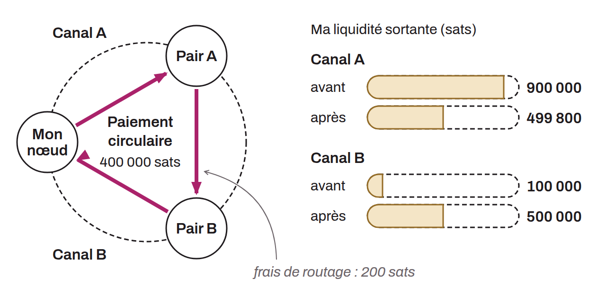

Paiement qu'un nœud Lightning s'envoie à lui-même en empruntant un chemin passant par d'autres nœuds du réseau. L'objectif est de déplacer de la liquidité d'un canal vers un autre sans ouvrir ni fermer de canal. Par exemple, si un nœud dispose de beaucoup de liquidité sortante sur un canal A mais manque de liquidité sortante sur un canal B, il peut s'envoyer un paiement circulaire qui sort par A et revient par B, rééquilibrant ainsi les deux canaux. Cette opération a un coût correspondant aux frais de routage prélevés par les nœuds intermédiaires.

