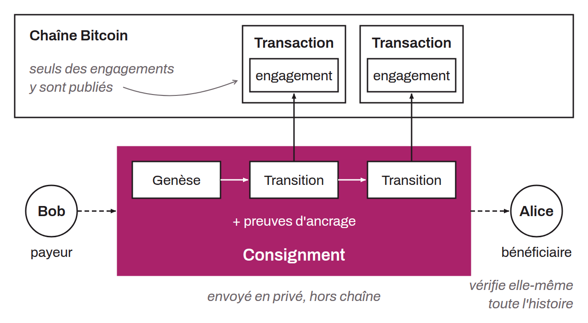

Processus par lequel chaque partie (client) vérifie un ensemble de données échangées en privé, selon les règles d'un protocole. Dans le cas du protocole RGB, ces données échangées sont regroupées dans ce qu'on appelle des consignments. Contrairement au protocole Bitcoin qui exige que toutes les transactions soient publiées on-chain, RGB permet de ne stocker en public que des commitments (ancrés dans Bitcoin), tandis que l'essentiel des informations de contrat (transitions, attestations, preuves) reste off-chain, partagé seulement entre les utilisateurs concernés.

