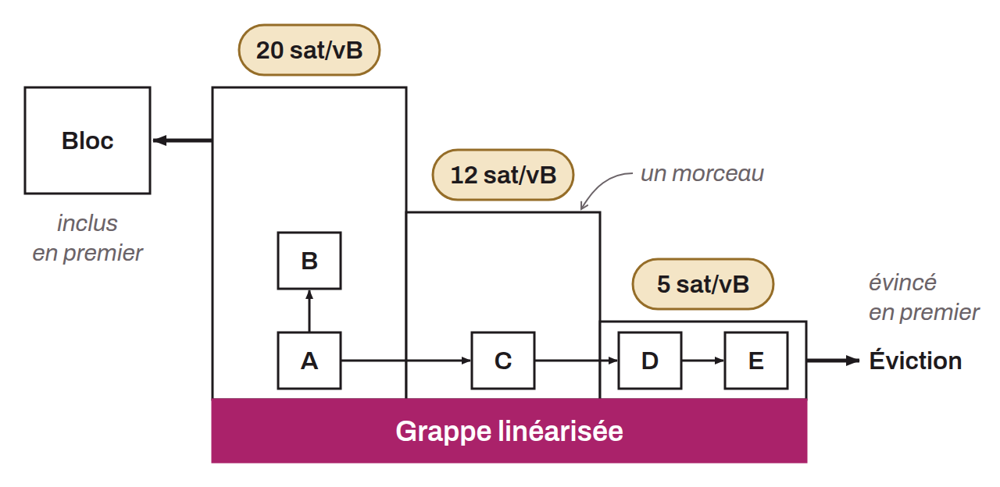

Refonte de la gestion de la mempool, livrée dans Bitcoin Core 31.0. La cluster mempool organise les transactions non confirmées en « grappes » (*clusters*) : des ensembles de transactions liées par des relations parent-enfant. Au sein de chaque grappe, un algorithme de linéarisation pré-calcule l'ordre optimal de minage et regroupe les transactions en « morceaux » (*chunks*) triés par taux de frais décroissant.

Cette refonte corrige une incohérence de l'ancienne mempool. La sélection des transactions pour le minage utilisait le taux de frais ancêtre le plus élevé, tandis que l'éviction utilisait le taux de frais descendant le plus faible. Comme ces deux heuristiques n'étaient pas symétriques, il pouvait arriver que la meilleure transaction de la mempool soit évincée en premier. Avec la cluster mempool, la construction de blocs et l'éviction deviennent des opérations exactement inverses : on inclut les morceaux du plus rentable au moins rentable, et on évicte dans l'ordre inverse.

Cette approche est viable grâce à la limitation de la taille des grappes, qui remplace les anciennes limites d'ancêtres et de descendants (par défaut dans Bitcoin Core 31.0, 64 transactions et 101 kB de taille virtuelle par grappe). Comme les morceaux optimaux ne franchissent jamais les frontières entre grappes, l'ajout d'une transaction ne nécessite de recalculer que sa propre grappe. Le taux de frais de chaque morceau sert alors de score unifié pour toutes les opérations de la mempool : construction de blocs, éviction, évaluation du RBF, relais de transactions et estimation des frais.
