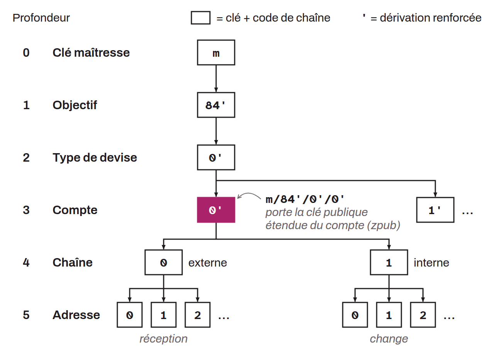

Dans les portefeuilles HD (déterministes hiérarchiques), un compte représente une couche de dérivation à la profondeur 3 selon le BIP-0044 (le BIP-0032 le plaçait à la profondeur 1). Chaque compte est numéroté séquentiellement à partir de `/0'/` (dérivation renforcée, donc en réalité `/2^31/` ou `/2 147 483 648/`). C'est à cette profondeur de dérivation que se trouvent les fameuses `xpub`. De nos jours, on utilise généralement un seul compte au sein d'un portefeuille HD. Mais initialement, ils avaient été imaginés pour pouvoir ségréguer diverses catégories d'utilisation au sein d'un même portefeuille. Par exemple, si l'on prend un chemin de dérivation standard pour une adresse de réception Taproot externe (P2TR) : `m/86'/0'/0'/0/0`, l'index du compte est le second `/0'/`.

