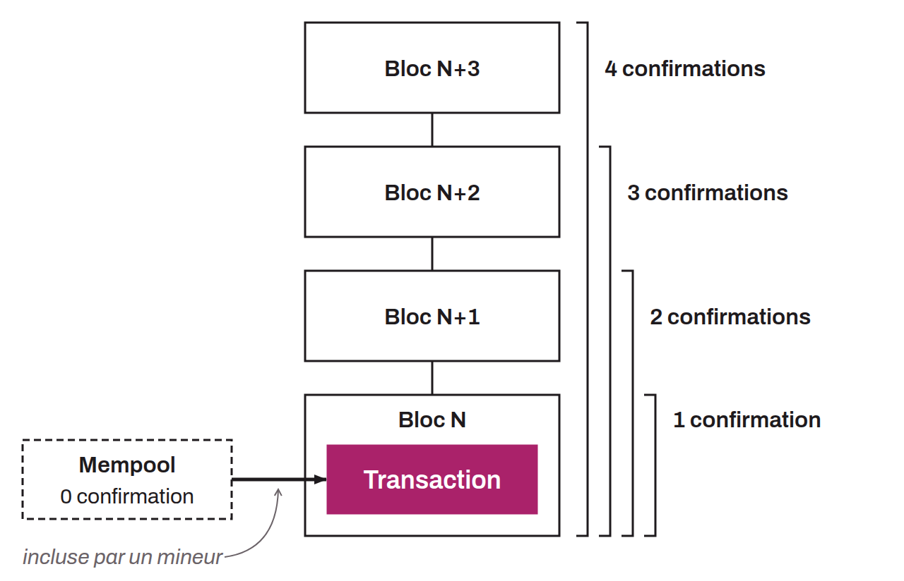

Correspond au nombre de blocs pour lesquels une transaction bénéficie de leur sécurité. Lorsque l'on diffuse une transaction au réseau Bitcoin, celle-ci est d'abord en attente dans les mempools des nœuds. Elle est ensuite incluse dans un bloc valide par un mineur. À ce stade, la transaction vient d'être ajoutée à la blockchain, elle bénéficie donc d'une première confirmation. Lorsqu'un nouveau bloc sera trouvé par-dessus le bloc où se trouve la transaction en question, elle bénéficiera d'une seconde confirmation, et ainsi de suite. Chaque nouveau bloc miné par-dessus le bloc contenant la transaction constitue une nouvelle confirmation. Grâce au comptage du nombre de confirmations pour une transaction, on peut estimer le risque qu'elle puisse être finalement annulée à cause d'une réorganisation. Le nombre de confirmations nous permet de juger du niveau d'immuabilité d'une transaction sur la blockchain.

