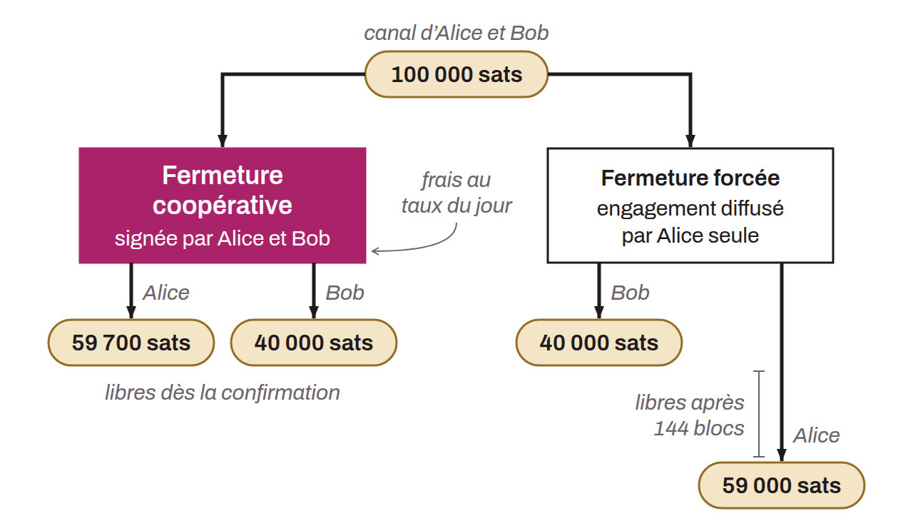

Fermeture d'un canal Lightning réalisée avec l'accord mutuel des deux parties. C'est la méthode de fermeture la plus avantageuse : les deux partenaires du canal signent conjointement une transaction de clôture qui redistribue les fonds vers leurs adresses respectives, sans timelock.

Contrairement à une fermeture forcée (*force close*), où une transaction d'engagement unilatérale est diffusée et impose un *timelock* avant que les fonds ne soient accessibles, la fermeture coopérative produit une transaction simple. Les frais de minage sont donc réduits (puisqu'ils peuvent être ajustés au marché de frais du moment), et les fonds sont disponibles dès la confirmation de la transaction.

