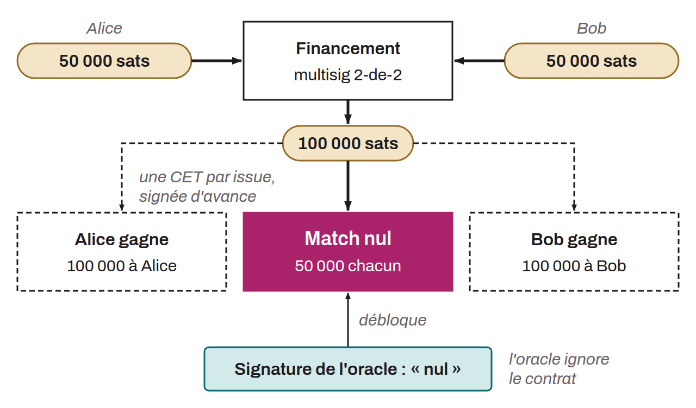

Type de contrat intelligent sur Bitcoin qui permet l'exécution de conditions contractuelles à partir du résultat d'événements externes, validés par un ou plusieurs oracles, sans que ces derniers connaissent les détails du contrat. Les DLC ont été inventés par Tadge Dryja en 2017. Ces contrats intelligents sont principalement utiles dans des applications financières, permettant, par exemple, de créer des instruments financiers ou des paris conditionnels, tout en réduisant les risques de contrepartie. Pour construire un DLC, deux parties bloquent des bitcoins sur une adresse multisig 2-de-2. Ces bitcoins sont débloqués lorsque l'oracle publie les informations spécifiées à un moment donné ; si l'oracle ne publie rien, une transaction de remboursement, verrouillée jusqu'à une date convenue, rend à chaque partie sa mise.

