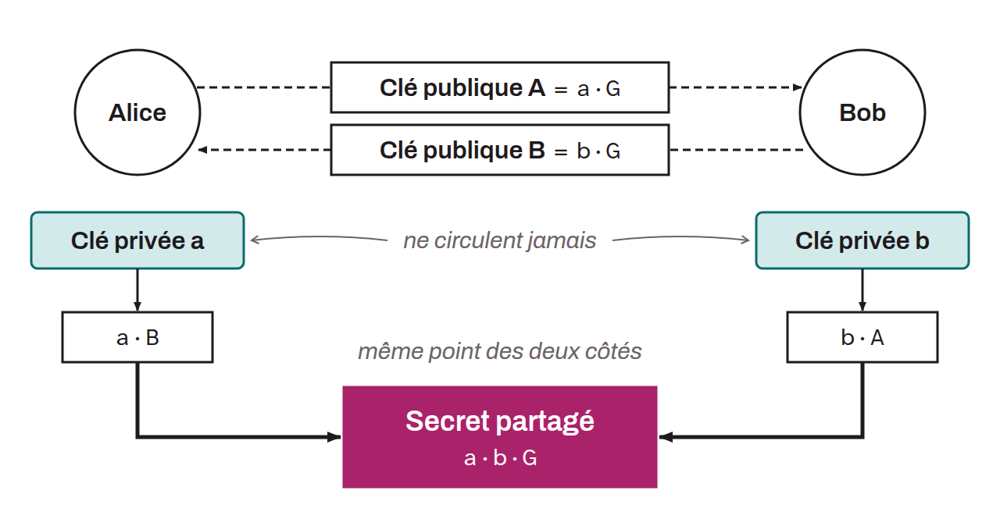

Méthode d'échange de clés cryptographiques établie sur les principes de l'échange de clés Diffie-Hellman, mais qui utilise des courbes elliptiques pour fournir un niveau de sécurité élevé avec des tailles de clés plus petites. Ce protocole permet à deux parties de générer un secret partagé en utilisant leurs paires de clés publiques et privées, sans jamais avoir à échanger les clés privées elles-mêmes. Le secret partagé peut ensuite être utilisé pour chiffrer une communication ultérieure. On retrouve parfois l'utilisation de cet algorithme dans des propositions d'amélioration de Bitcoin, notamment le BIP-0047 ou le BIP-0352 pour la dérivation d'adresses de réception vierges à partir d'un identifiant statique.

