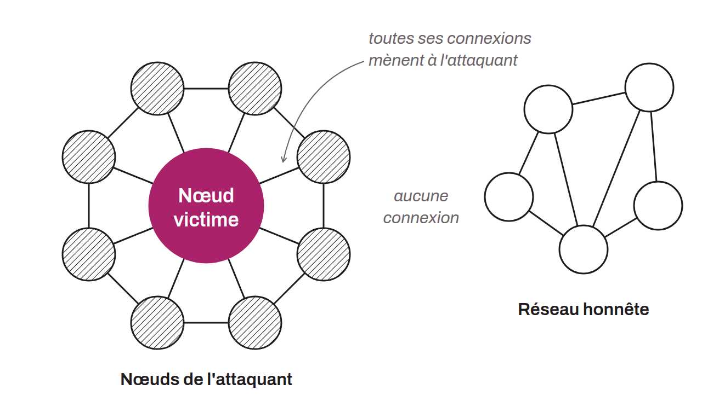

Attaque qui consiste à isoler et à contrôler les communications d'un nœud dans un réseau en créant un environnement artificiel autour de lui. L'objectif est de filtrer ou de manipuler les informations reçues et envoyées par ce nœud, le coupant ainsi de ses pairs légitimes. Dans le cadre de Bitcoin, cette technique peut être utilisée pour induire en erreur un nœud, censurer ou altérer les données qu'il reçoit ou envoie, ou pour mener des attaques de doubles dépenses.

