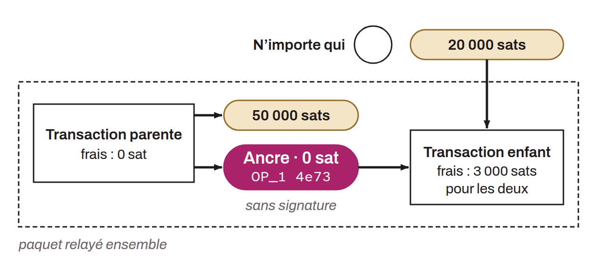

Politique de relais qui autorise la diffusion de transactions à frais nuls sur le réseau, à condition qu'elles soient accompagnées d'une transaction enfant qui paie des frais suffisants pour les deux. La transaction parente contient une sortie de valeur nulle avec un script *anyone-can-spend*, ce qui permet à n'importe quel participant du réseau de créer une transaction enfant qui dépense cette sortie éphémère en y attachant les frais appropriés au moment de la diffusion.

Ce mécanisme résout un problème fondamental des protocoles de contrat comme le Lightning Network : les transactions sont signées par les participants bien avant leur diffusion, ce qui empêche de déterminer à l'avance un taux de frais adapté aux conditions du réseau. Les *ephemeral anchors* permettent de reporter le choix des frais au moment de la publication, en offrant une forme de « parrainage de frais » (*fee sponsorship*) accessible à toute partie, qu'elle soit ou non bénéficiaire des autres sorties de la transaction.

Ce mécanisme s'appuie sur les règles de relais des transactions v3 (TRUC) et sur le *package relay*. Elle constitue une évolution des *anchor outputs* traditionnels du Lightning Network, eux-mêmes fondés sur la règle de *CPFP carve-out*. Bitcoin Core 28.0 a introduit les règles TRUC et le type de sortie standard *Pay-To-Anchor* (P2A) pour ce mécanisme, puis Bitcoin Core 29.0 a ajouté la règle de la poussière éphémère (*ephemeral dust*), qui admet une sortie sous le seuil de poussière dans une transaction à frais nuls. Les *ephemeral anchors* constituent également une contre-mesure efficace face aux attaques d'épinglage de transaction.
