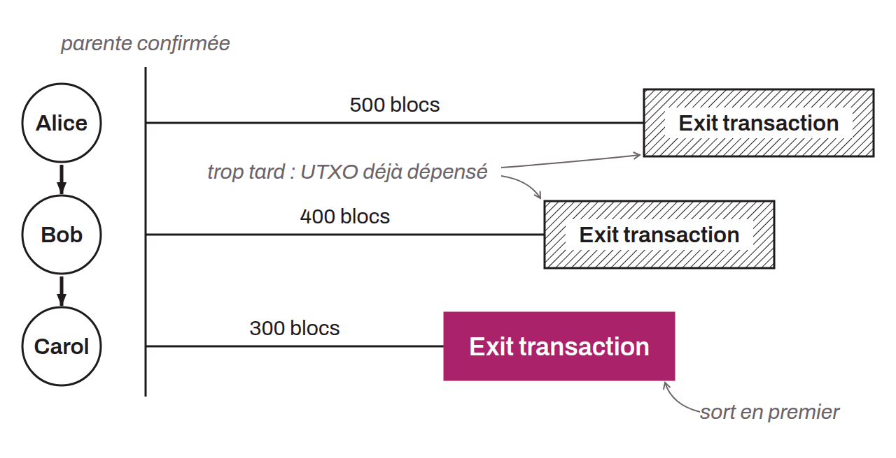

Transaction Bitcoin pré-signée permettant à un utilisateur de retirer unilatéralement ses fonds depuis Spark (ou une statechain) vers la couche principale, sans nécessiter la coopération de la *Spark Entity*.

L'exit transaction est créée et co-signée par l'utilisateur et la SE au moment où l'utilisateur reçoit des fonds sur Spark. Chaque nouveau propriétaire obtient une exit transaction dotée d'un *timelock* relatif plus court que celui du propriétaire précédent. Cette hiérarchie décroissante de timelocks assure que le propriétaire actuel peut toujours publier sa transaction on-chain avant les anciens propriétaires, empêchant ainsi les tentatives de double dépense. Pour sortir, l'utilisateur diffuse l'exit transaction ainsi que ses transactions parentes sur le réseau Bitcoin.

