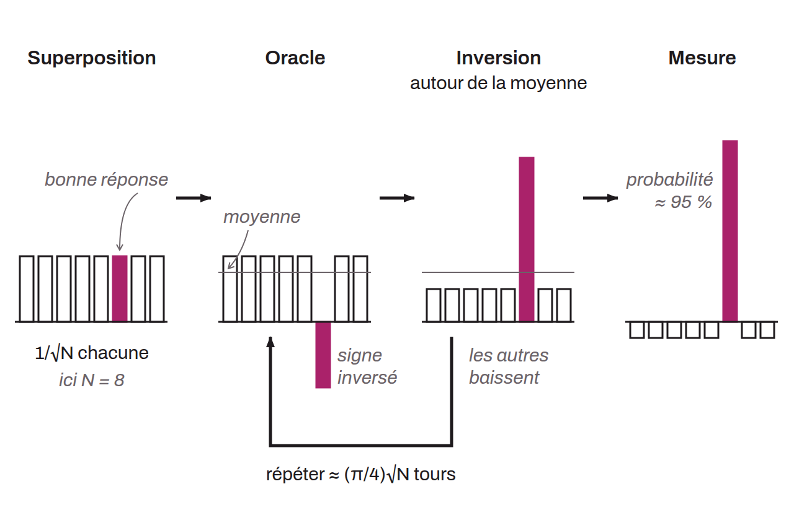

Algorithme quantique publié en 1996 par Lov Grover, chercheur aux Bell Labs, qui retrouve l'élément satisfaisant une condition parmi $N$ possibilités rangées sans aucun ordre en un nombre d'évaluations de l'ordre de $\sqrt{N}$, là où un ordinateur classique doit en examiner $N/2$ en moyenne. Il accélère ainsi toute recherche par force brute, mais de façon seulement quadratique : une recherche parmi $2^{256}$ possibilités demande encore de l'ordre de $2^{128}$ évaluations. Sur Bitcoin, il concerne les fonctions de hachage et la preuve de travail, alors que les signatures ECDSA et Schnorr sont menacées par l'algorithme de Shor, qui résout le logarithme discret exponentiellement plus vite qu'un ordinateur classique.

Grover illustre le problème par un annuaire de $N$ noms classés au hasard, dans lequel on cherche le numéro d'une personne : un ordinateur classique doit lire $N/2$ entrées pour avoir une chance sur 2 de le trouver. L'ordinateur quantique, lui, place ses qubits dans une superposition de toutes les entrées, chacune avec la même amplitude $1/\sqrt{N}$, puis répète une boucle de deux opérations. L'oracle teste la condition et inverse le signe de l'amplitude du seul état qui la satisfait. Une « inversion autour de la moyenne » reflète ensuite chaque amplitude par rapport à la moyenne de toutes, ce qui fait passer l'état marqué, devenu négatif, au-dessus des autres. Tant que l'amplitude de la bonne réponse reste faible, chaque tour l'augmente de l'ordre de $1/\sqrt{N}$ ; après environ $\frac{\pi}{4}\sqrt{N}$ tours, une mesure la donne presque à coup sûr.

Contre une fonction de hachage, l'oracle vérifie si une entrée produit l'empreinte visée, ce qui l'oblige à calculer la fonction elle-même sur des qubits. Pour trouver une préimage d'une empreinte `SHA256` parmi $2^{256}$ valeurs possibles, la force brute demande de l'ordre de $2^{255}$ essais et Grover de l'ordre de $2^{128}$. Selon le rapport publié par Chaincode en mai 2025, la sécurité de `SHA256` et de `RIPEMD160` en sort affaiblie mais pas cassée, et Bitcoin Optech note qu'on compense cette perte en passant à un algorithme qui offre deux fois plus de bits de sécurité, par exemple de `SHA256` à `SHA512`. Le coût réel dépasse d'ailleurs le simple compte des évaluations : en 2016, Matthew Amy et ses coauteurs ont chiffré le circuit de cette attaque à environ $2^{12{,}6}$ qubits logiques (quelque 6 000 qubits fiables obtenus par correction d'erreurs) maintenus pendant $2^{153{,}8}$ cycles de correction, soit selon eux jusqu'à 275 milliards de fois plus cher que ne le laisse croire le nombre d'évaluations.

Le même rapport qualifie de relativement résistantes au quantique les adresses qui ne contiennent qu'une empreinte de clé publique ou de script (P2PKH, P2SH, P2WPKH, P2WSH), tant que la clé n'a pas été révélée : avant de pouvoir appliquer l'algorithme de Shor, un attaquant devrait inverser l'empreinte avec Grover pour obtenir une clé publique qui la produit. Les empreintes de 160 bits laissent moins de marge. Sur Delving Bitcoin, le 5 mai 2026, Olaoluwa Osuntokun chiffre une préimage de `RIPEMD160` à $2^{80}$ opérations avec Grover, contre $2^{128}$ pour `SHA256`, et propose de remplacer l'empreinte `RIPEMD160` du *payment hash* qui figure dans les scripts des HTLC de Lightning (BOLT-03) par une empreinte `SHA256`.

La principale limite de Grover tient à son caractère séquentiel. Christof Zalka a démontré en 1997 qu'on ne peut pas mieux le paralléliser qu'en découpant l'espace de recherche entre des ordinateurs quantiques indépendants : avec $S$ machines, chacune doit encore effectuer environ $\sqrt{N/S}$ tours, si bien que 100 fois plus de machines ne divisent le temps que par 10, alors qu'une recherche classique se répartit sans perte. Le NIST le rappelle dans ses critères de sécurité post-quantiques : les architectures quantiques envisagées lors de leur rédaction n'exécuteraient qu'environ $2^{40}$ portes logiques en série par an, et une attaque réaliste par Grover doit lancer de nombreuses petites instances en parallèle, avec un gain moins spectaculaire que le gain théorique.

Le minage est lui aussi une recherche par force brute : le mineur fait varier le nonce et d'autres champs de l'en-tête de bloc jusqu'à obtenir un double `SHA256` inférieur ou égal à la cible. Grover y apporte en théorie un gain quadratique, mais un mineur quantique devrait rivaliser avec des ASIC. En 2017, Divesh Aggarwal et ses coauteurs estimaient qu'une machine quantique aux caractéristiques exigeantes mais plausibles atteindrait 13,8 GH/s, plus de 1 000 fois moins qu'un ASIC de l'époque. Le rapport de Chaincode conclut que cette menace reste limitée par des contraintes physiques et économiques, tout en notant que Grover, parce qu'il se parallélise mal, avantagerait de façon disproportionnée les mineurs dotés des machines quantiques les plus rapides.

Le minage quantique ouvre aussi des attaques nouvelles. En mars 2024, Bolton Bailey et Or Sattath ont décrit une attaque des 51 % menée par un seul mineur quantique doté d'une faible puissance de hachage, présentée ensuite sur la liste bitcoindev. Sur une chaîne privée, ce mineur manipule les horodatages pour multiplier la difficulté par un facteur $c$ : chaque bloc y compte $c$ fois plus de travail mais ne lui coûte que $\sqrt{c}$ fois plus d'efforts grâce à Grover, si bien que sa chaîne, plus courte, finit par porter plus de travail cumulé que la chaîne honnête. L'attaque exige un ordinateur quantique extrêmement rapide et tolérant aux fautes, probablement hors de portée dans les années à venir.

Grover sert enfin de brique à l'algorithme de Gilles Brassard, Peter Høyer et Alain Tapp (1997), qui cherche des collisions, c'est-à-dire deux entrées donnant la même empreinte, en moins d'évaluations que tout algorithme classique, au prix d'une mémoire considérable : Osuntokun chiffre ainsi une collision sur `RIPEMD160` à $2^{53}$ opérations.

Lov Grover a présenté son algorithme en mai 1996 au STOC, le symposium de l'ACM consacré à la théorie du calcul. En 1997, Charles Bennett, Ethan Bernstein, Gilles Brassard et Umesh Vazirani ont prouvé qu'aucun algorithme quantique ne fait mieux que de l'ordre de $\sqrt{N}$ étapes pour une recherche non structurée, ce qui rend Grover optimal à une constante près. Zalka a ensuite montré qu'il l'est exactement.

*En anglais, on parle de Grover's algorithm.*
