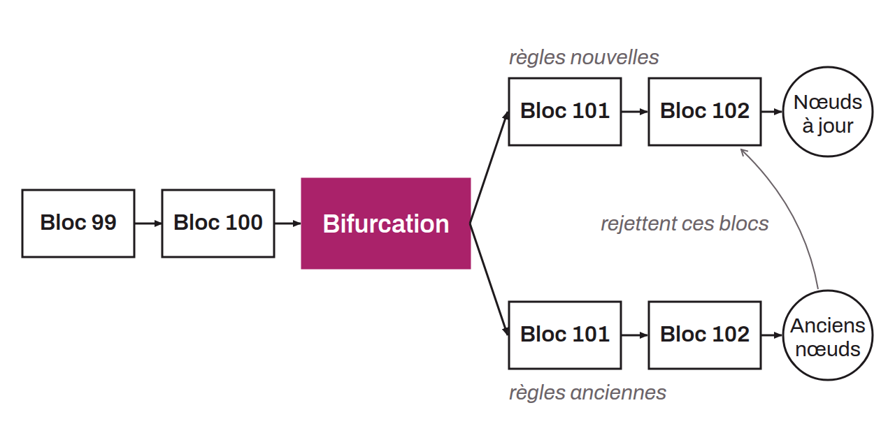

Modification des règles du protocole de manière non rétrocompatible. Si une partie des nœuds ne l'adopte pas, cette modification donne lieu à une séparation du réseau de nœuds Bitcoin en deux groupes distincts : les nœuds avec la mise à jour et les nœuds sans la mise à jour. Cette scission se matérialise par la division de la blockchain originale en deux blockchains distinctes, partageant toutefois un historique commun, d'où l'usage du terme « fork », traduisible en français par « embranchement, bifurcation ».

Une modification est dite non rétrocompatible lorsqu'elle est soit extensive, c'est-à-dire qu'elle supprime ou rend moins restrictives certaines règles du protocole, soit bilatérale, c'est-à-dire qu'elle ajoute des règles incompatibles avec les anciennes. En d'autres termes, un hard fork s'observe lorsque certains nœuds font en sorte qu'un bloc invalide devienne valide. En résulte alors la formation d'une nouvelle version du protocole, qui peut soit remplacer le Bitcoin original si une majorité est trouvée, soit devenir un altcoin indépendant s'il n'est qu'utilisé en marge. Par exemple, Bitcoin Cash (BCH) est un hard fork de Bitcoin. L'embranchement a eu lieu au bloc n° 478 559, le 1er août 2017.
