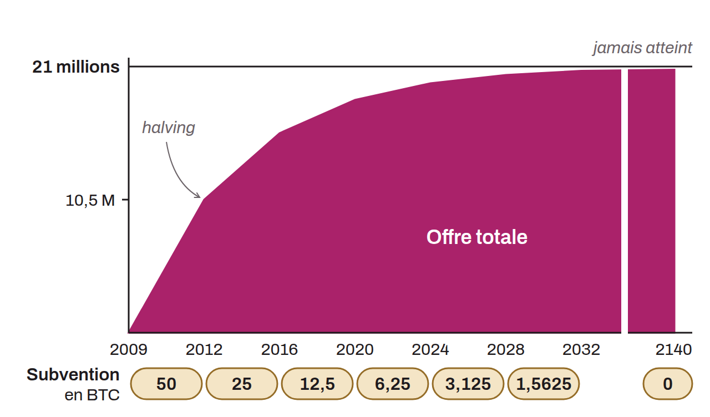

Plafond fixé pour la masse monétaire totale de BTC, établie à environ 21 millions d'unités. Cette limite est définie par la politique d'inflation dans le protocole Bitcoin. De nouveaux BTC sont créés et distribués aux mineurs via la subvention pour la validation de chaque bloc. Cette subvention est réduite de moitié tous les 210 000 blocs, un processus connu sous le nom de « *halving* ». Cette méthode garantit que la création monétaire décroîtra progressivement jusqu'à atteindre zéro.

