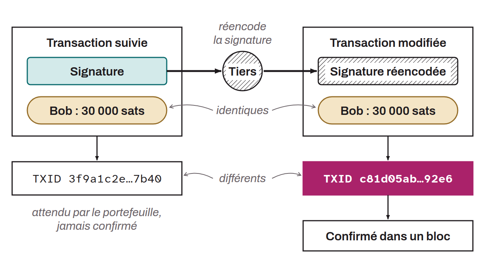

Se réfère à la possibilité de modifier légèrement la structure d'une transaction Bitcoin, sans en altérer l'effet, mais tout en changeant l'identifiant de transaction (*TXID*). Cette propriété peut être exploitée de manière malveillante pour induire en erreur les parties prenantes sur le statut d'une transaction : le TXID suivi par une plateforme ou un portefeuille peut ne jamais apparaître dans un bloc, alors qu'une version modifiée de la même transaction y est confirmée. La malléabilité était rendue possible par la flexibilité de la signature numérique et du `scriptSig` (BIP-0062). La malléabilité rendait notamment compliquée une implémentation du Lightning Network. Le soft fork SegWit a été introduit pour résoudre ce problème, en écartant les données malléables de la transaction du calcul du TXID.

*Bien que ce soit rare, on retrouve parfois le terme de « mutabilité » pour évoquer le même concept.*
