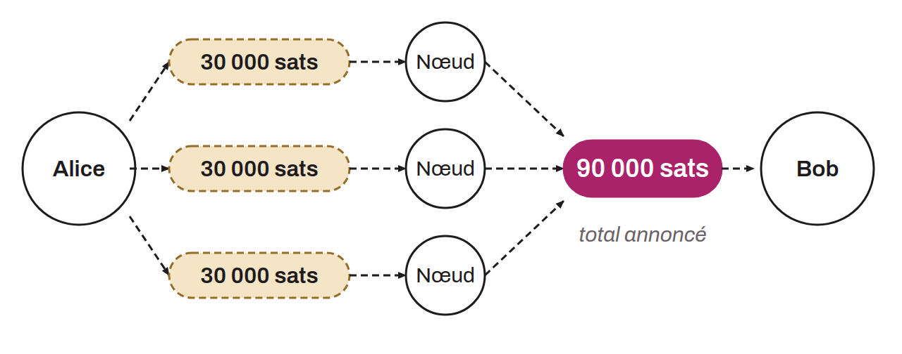

Terme générique pour désigner toutes les techniques de paiement sur Lightning qui permettent de fractionner une transaction en plusieurs petites parties pour les acheminer via différentes routes. Autrement dit, chaque fraction de paiement emprunte un chemin de nœuds différent. Cela permet de contourner les limitations de liquidité sur un canal unique dans la route.

Les paiements multi-path offrent également de légers avantages en termes de confidentialité, car il devient plus difficile pour un observateur de lier chaque fraction de paiement à l'ensemble de la transaction. Toutefois, dans sa version de base, tous les fragments partagent le même secret pour les HTLCs, ce qui peut rendre la transaction traçable si un observateur est présent sur plusieurs routes. De plus, du fait que le secret est unique pour toutes les fractions du paiement, celui-ci n'est pas atomique au sens strict. Les spécifications demandent au destinataire de ne révéler la préimage qu'après avoir reçu toutes les fractions, mais rien ne l'y contraint cryptographiquement : un destinataire malhonnête pourrait réclamer une partie seulement. Ces inconvénients sont corrigés avec les « *Atomic Multi-Path Payment* ».

*On parle également parfois de « Multi-Part Payment » pour désigner cette même méthode.*
