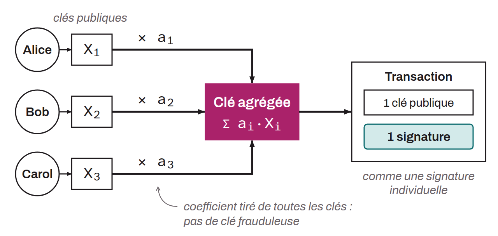

Protocole de multisignature Schnorr n-de-n proposé en 2018 par Gregory Maxwell, Andrew Poelstra, Yannick Seurin et Pieter Wuille. Il agrège les clés publiques de plusieurs signataires en une seule clé et produit une unique signature valide, indiscernable d'une signature individuelle sur la blockchain. Pour contrer l'attaque par clé frauduleuse (« *rogue key attack* »), dans laquelle un participant manipule sa clé publique pour contrôler seul la clé agrégée, le protocole multiplie chaque clé par un coefficient dérivé de l'ensemble des clés.

Le processus de signature se déroule en trois tours de communication : échange d'engagements cryptographiques sur les nonces, révélation des nonces, puis échange des signatures partielles. Cette structure en trois tours protège contre les attaques par manipulation de nonces, mais impose une interactivité contraignante. MuSig a été supplanté par MuSig2, qui ramène le processus à deux tours.
