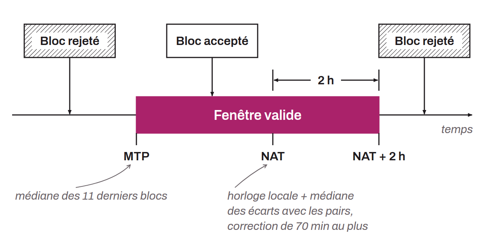

Estimation du temps universel établie sur les horloges des nœuds du réseau. Chaque nœud calcule son NAT en prenant la médiane des différences de temps entre son horloge locale (UTC) et celles des nœuds avec lesquels il est connecté, puis en additionnant son horloge locale avec la médiane de ces différences, jusqu'à un maximum de 70 minutes. Le *network-adjusted time* est donc une médiane du temps des nœuds calculée en local par chaque nœud. Jusqu'à Bitcoin Core 26, ce référentiel servait à vérifier la validité des horodatages des blocs : pour qu'un bloc soit accepté par un nœud, son horodatage devait se situer entre le MTP (temps médian des 11 derniers blocs minés) et le NAT plus 2 heures :



```text
MTP < Horodatage valide < (NAT + 2h)
```

Depuis Bitcoin Core 27.0, le NAT a été retiré du code de consensus et remplacé par l'heure système du nœud, non ajustée : la borne est désormais l'heure système plus 2 heures. Le nœud continue de mesurer l'écart médian avec ses pairs, mais seulement pour afficher un avertissement à partir de 70 minutes d'écart.
