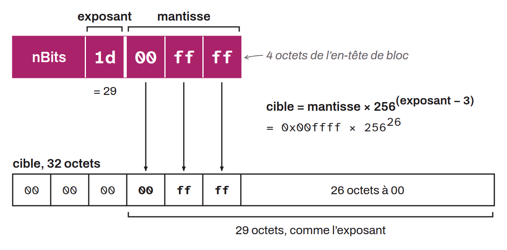

Champ de 4 octets présent dans l'en-tête de chaque bloc Bitcoin, qui encode la cible de difficulté sous une forme compacte : le premier octet indique le nombre d'octets de la cible complète (l'exposant), et les trois octets suivants constituent la mantisse (les chiffres significatifs de la cible). La formule de décodage est : $cible = mantisse \times 256^{(exposant - 3)}$.

Un hash de bloc doit être inférieur ou égal à la valeur cible encodée dans `nBits` pour que le bloc soit considéré comme valide. Ce champ est recalculé tous les 2 016 blocs lors de l'ajustement de la difficulté, afin de maintenir un intervalle moyen d'environ 10 minutes entre chaque bloc.
