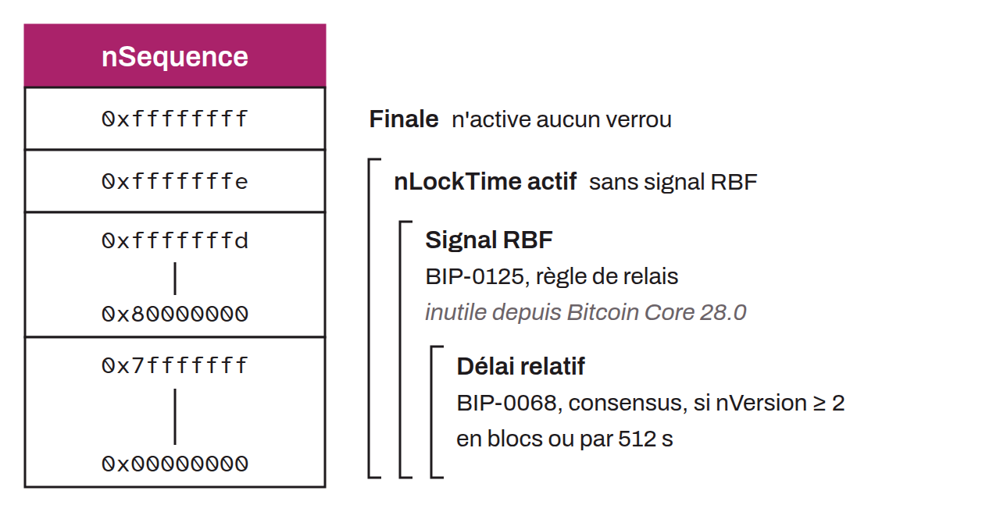

Le champ `nSequence` dans une entrée de transaction Bitcoin est utilisé pour indiquer la manière dont cette entrée est verrouillée dans le temps. À l'origine, il visait à permettre le remplacement dynamique de transactions dans les mempools afin de permettre un système de paiement en surcouche similaire à Lightning. Toutefois, son utilisation a évolué avec l'introduction du timelock relatif via le BIP-0068. Le champ `nSequence` peut désormais spécifier un délai relatif avant qu'une transaction soit incluse dans un bloc. Ce délai peut être défini en termes de nombre de blocs, ou bien comme un multiple de 512 secondes (c'est-à-dire, du temps réel). Notons que cette nouvelle interprétation du champ `nSequence` est uniquement valide si le champ `nVersion` est supérieur ou égal à `2` et si le bit 31 du champ `nSequence` (le drapeau de désactivation) vaut zéro, c'est-à-dire pour une valeur inférieure ou égale à `0x7fffffff`. Cette interprétation du champ `nSequence` se fait au niveau des règles de consensus de Bitcoin. Par ailleurs, au niveau des règles de standardisation, ce champ est également utilisé pour le signalement de RBF. Si une transaction inclut un `nSequence` inférieur à `0xfffffffe`, alors elle signale qu'elle est remplaçable via RBF (BIP-0125). Ce signalement n'est plus nécessaire dans Bitcoin Core : depuis la version 28.0, le remplacement complet (*full RBF*) est activé par défaut, et l'option `mempoolfullrbf` a été retirée dans la version 29.0.

