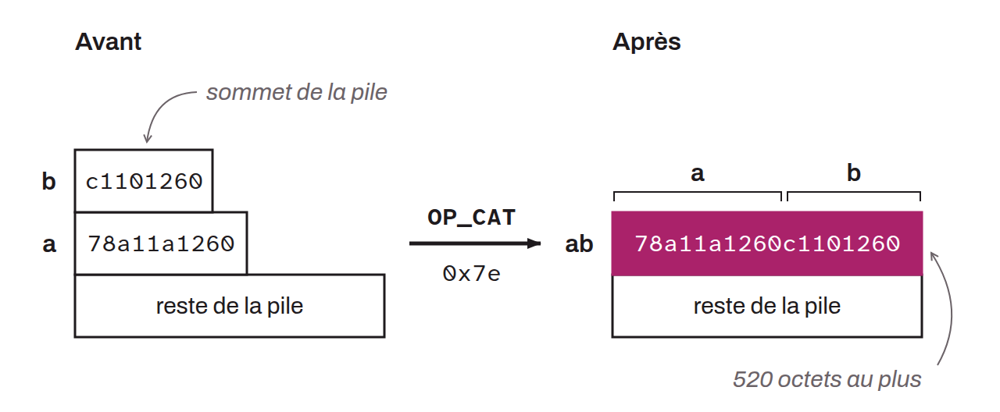

Permet de concaténer les deux éléments en haut de la pile (c'est-à-dire de les mettre bout-à-bout). Cet opcode est désactivé dans Bitcoin : un script qui le contient est invalide, il est donc impossible de l'utiliser. Toutefois, le BIP-0347 propose de l'ajouter à Tapscript afin de permettre la combinaison d'objets sur la pile, et ainsi améliorer l'expressivité de ce langage. Ce simple outil supplémentaire pourrait permettre :
* L'utilisation des signatures de Lamport qui sont a priori résistantes aux attaques quantiques ;
* La mise en place de Vaults ;
* L'utilisation de covenants ;
* Ou encore, l'utilisation de contrats de non-équivocation.

