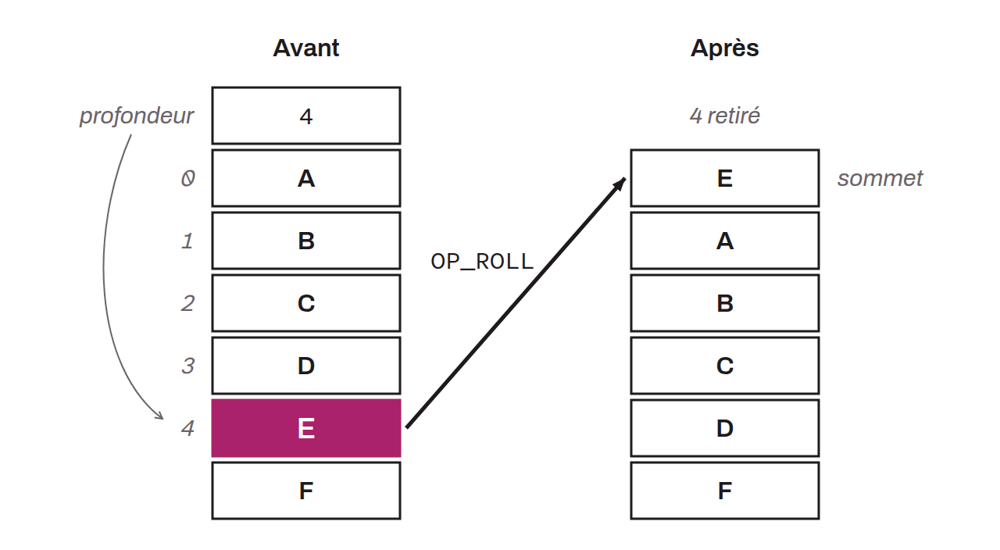

Déplace un élément de la pile en haut de la pile, en fonction de la profondeur spécifiée par la valeur en haut de la pile avant l'opération. Par exemple, si la valeur en haut de la pile est `4`, `OP_ROLL` va sélectionner le cinquième élément de la pile en partant du sommet (l'indexation commence à `0`), et il va déplacer cette valeur au sommet. `OP_ROLL` joue le même rôle que `OP_PICK`, mis à part qu'il retire l'élément de sa position initiale.

