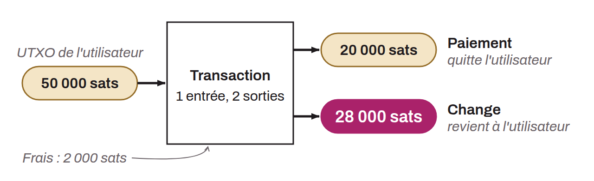

*Pattern* (ou modèle) de transaction utilisé en analyse de chaîne qui se caractérise par la consommation d'un ou plusieurs UTXOs en inputs et la production de 2 UTXOs en outputs. Ce modèle va donc ressembler à cela :

Ce modèle du paiement simple indique que nous sommes vraisemblablement en présence d'une transaction d'envoi ou de paiement. L'utilisateur a consommé son propre UTXO en inputs pour satisfaire en outputs un UTXO de paiement et un UTXO de change (rendu de monnaie qui revient vers le même utilisateur). Nous savons donc que l'utilisateur observé n'est vraisemblablement plus en possession d'un des deux UTXOs en outputs (celui du paiement), mais qu'il est toujours en possession de l'autre UTXO (celui de change).
