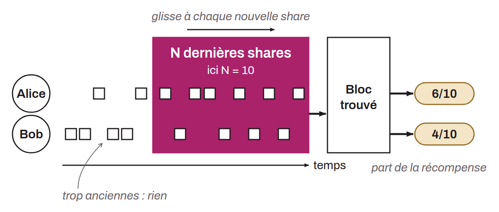

Méthode de calcul de la rémunération des mineurs dans le contexte des pools de minage. PPLNS récompense les mineurs en fonction de leur contribution en *shares* sur une période donnée. Dans PPLNS, les paiements sont effectués seulement lorsque la pool trouve un bloc et sont établis sur le nombre de *shares* soumises par le mineur par rapport au total des *shares* collectées pendant la période observée. Cette méthode favorise les mineurs constants et actifs sur le long terme, car elle décourage le *pool hopping* (changement fréquent de pool). La rémunération varie avec la probabilité de trouver un bloc, ce qui peut entraîner une baisse de la constance dans les revenus du mineur (plus de variance que le paiement à la tâche).

