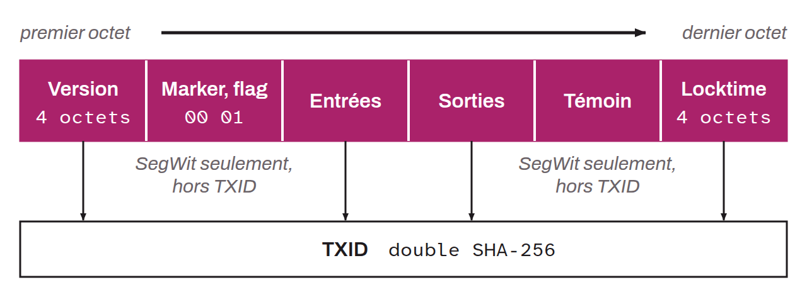

Transaction Bitcoin construite et signée, qui se trouve dans sa forme binaire. Une transaction brute (*raw TX*) est la représentation finale d'une transaction, juste avant qu'elle ne soit diffusée sur le réseau. Cette transaction contient toutes les informations nécessaires à son inclusion dans un bloc :
* La version ;
* Le *marker* et le *flag* (pour les transactions SegWit) ;
* Les inputs ;
* Les outputs ;
* Le witness (pour les transactions SegWit) ;
* Le locktime.

Ce que l'on appelle « *raw transaction* » représente les données brutes qui sont passées deux fois dans la fonction de hachage `SHA256` pour générer le TXID de la transaction. Pour les transactions SegWit, seule la sérialisation originale (sans le *marker*, le *flag* et le *witness*) est utilisée pour calculer le TXID. Ces données sont ensuite utilisées dans l'arbre de Merkle du bloc pour intégrer la transaction dans la blockchain.

*Ce concept est également parfois nommé « Serialized Transaction ».*
