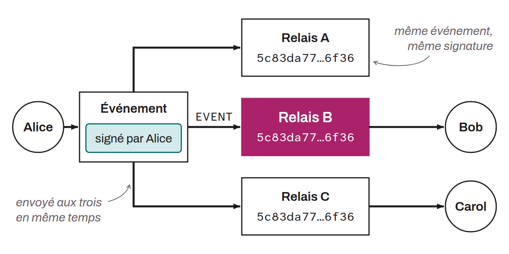

Serveur qui constitue l'infrastructure de distribution du protocole Nostr. Un relais accepte les événements publiés par les clients via des connexions WebSocket, les stocke (temporairement ou de façon permanente) et les retransmet aux clients abonnés selon des filtres de requête. Contrairement à un serveur centralisé classique, un relais ne peut pas modifier le contenu des événements qu'il transmet, car ceux-ci sont signés cryptographiquement par leurs auteurs. Chaque relais applique ses propres politiques de modération, de stockage et d'accès. Dans la pratique, on distingue plusieurs usages : des relais publics (ouverts à tous), privés (accès restreint), payants (nécessitant un abonnement) ou spécialisés (dédiés à certains types de contenu). Ce ne sont pas des catégories du protocole : NIP-11 permet seulement à un relais d'annoncer qu'il exige une authentification (NIP-42) ou un paiement. Un utilisateur Nostr se connecte généralement à plusieurs relais simultanément pour garantir la redondance et la résistance à la censure.

