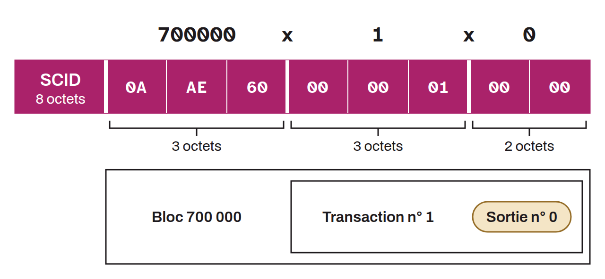

Identifiant compact utilisé sur le Lightning Network pour référencer de manière unique un canal de paiement. Plutôt que d'utiliser les clés publiques des deux nœuds ou le txid complet de la transaction de financement, le SCID encode la position exacte du canal dans la blockchain sous un format condensé.

Le SCID est composé de trois éléments concaténés sur 8 octets : le numéro du bloc contenant la transaction de financement (3 octets), l'index de cette transaction dans le bloc (3 octets), et l'index de la sortie (*output*) correspondant au canal (2 octets). Par exemple, un SCID `700000x1x0` signifie : bloc n°700 000, transaction n°1, sortie n°0.

