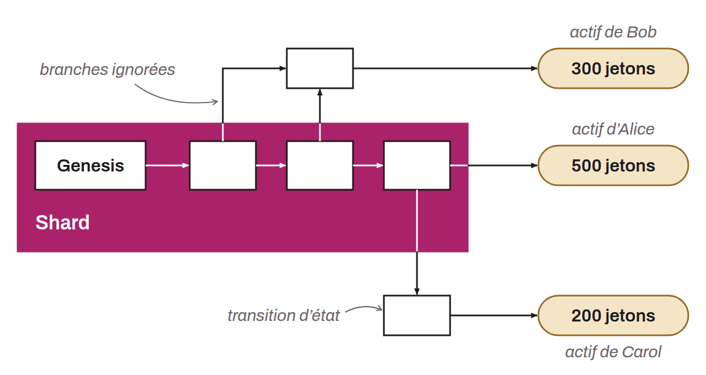

Dans le cadre du protocole RGB, un *Shard* représente une branche distincte au sein du graphe orienté acyclique (DAG) qui retrace l'historique des *State Transitions* d'un contrat. Il constitue un sous-ensemble cohérent de l'ensemble des transitions, correspondant par exemple à la séquence d'opérations nécessaires pour attester la validité d'un actif particulier depuis la *Genesis*. Ce mécanisme permet d'isoler des segments spécifiques de l'historique global, afin de faciliter la vérification côté client.

