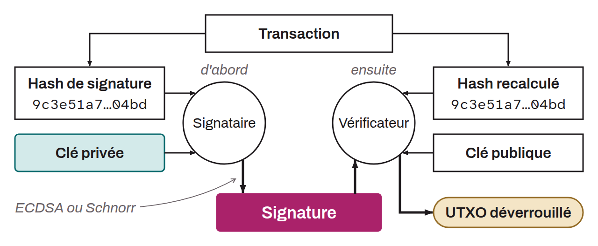

Preuve cryptographique qui démontre la possession d'une clé privée spécifique, associée à une clé publique unique, sans avoir à la divulguer. Sur Bitcoin, on la construit à l'aide de la clé privée et du hash de signature (*sighash*), calculé à partir des données de la transaction. Elle atteste la propriété des bitcoins concernés et permet de satisfaire un script qui déverrouille un UTXO. Elle est générée grâce à un algorithme de signature numérique sur courbe elliptique tel qu'ECDSA ou le protocole de Schnorr.

