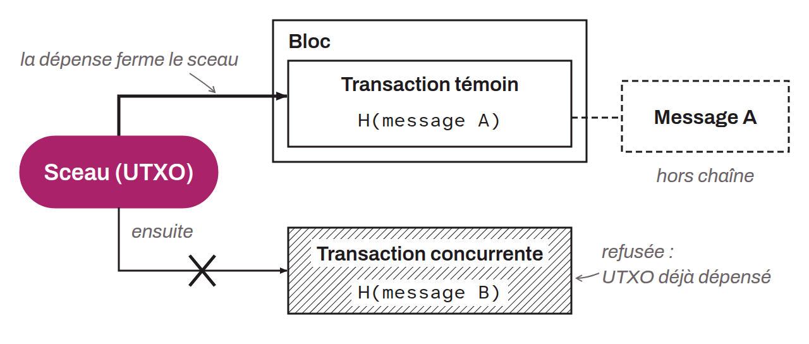

Désigne une promesse formelle de s'engager une seule fois sur un message encore inconnu, de sorte que le fait de l'engagement soit démontrablement connu de l'ensemble d'une audience déterminée. Ce mécanisme vise à prévenir la création de multiples engagements concurrents pour un même sceau, ce qui garantit l'unicité de chaque validation. En imposant cette contrainte d'utilisation unique, le Single-use Seal est utilisé sur RGB pour éviter la double-dépense.

