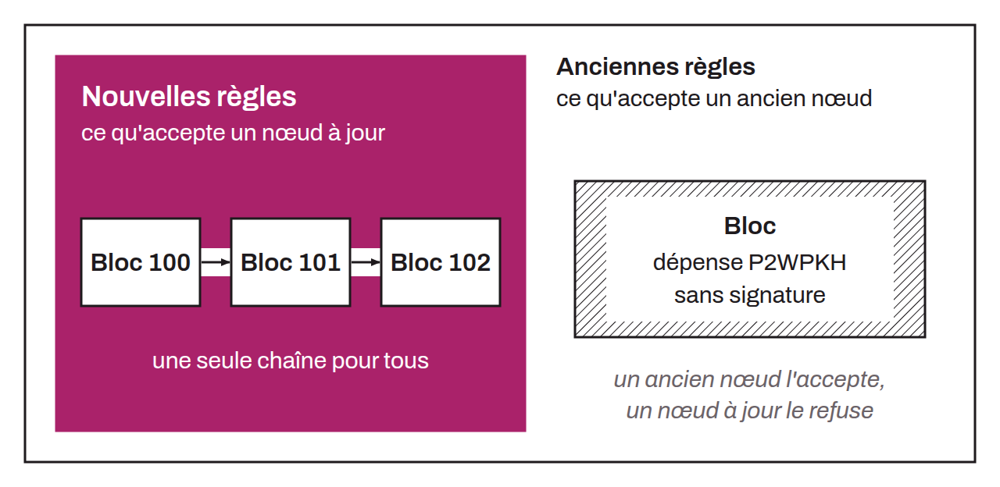

Modification des règles du protocole de manière rétrocompatible. Contrairement au hard fork, le soft fork ne donne pas lieu à une séparation du réseau de nœuds Bitcoin en deux groupes distincts, à condition qu'une majorité de la puissance de calcul se trouve sur la chaîne à jour. Si tout se passe bien, les nœuds avec la mise à jour et les nœuds sans la mise à jour restent donc sur la même blockchain. Une modification est rétrocompatible lorsqu'elle ajoute ou rend plus restrictives certaines règles du protocole.

