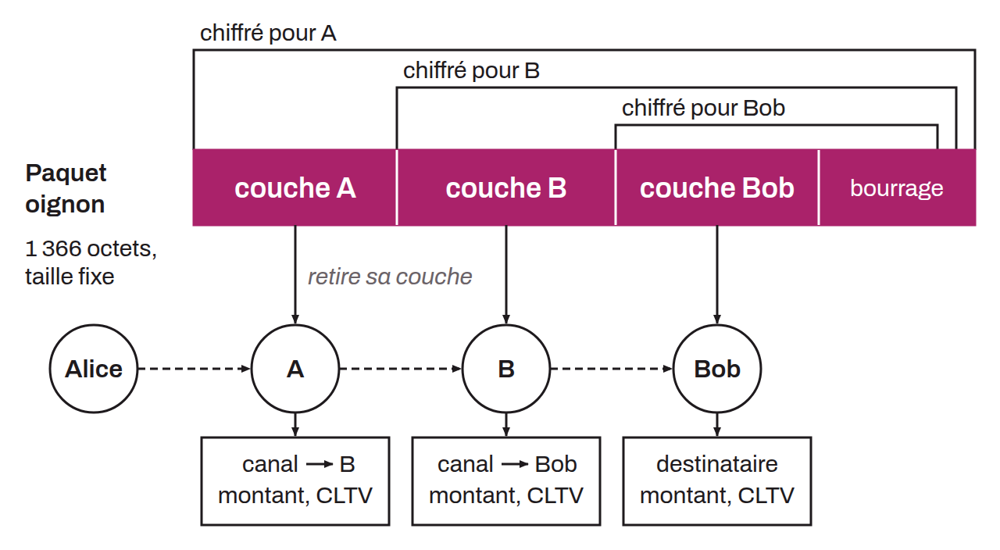

Format de paquets cryptographiques utilisé par le Lightning Network pour acheminer les paiements de manière privée via le routage en oignon. Conçu à l'origine par George Danezis et Ian Goldberg en 2009 pour les réseaux de mixage, il encapsule les instructions de routage dans des couches de chiffrement successives. Chaque nœud intermédiaire ne peut déchiffrer que la couche qui lui est destinée, révélant uniquement le prochain saut sans connaître l'expéditeur ni le destinataire final.

