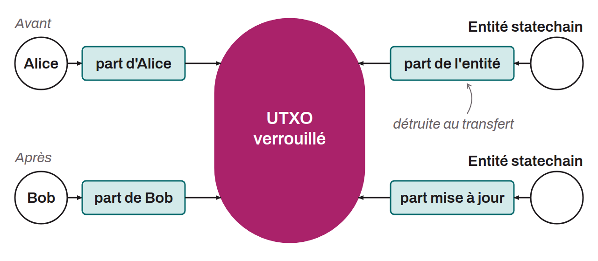

Mécanisme de couche supérieure sur Bitcoin permettant de transférer la propriété d'un UTXO hors chaîne, sans diffuser de transaction on-chain. Le concept a été proposé initialement par Ruben Somsen en 2018. Il repose sur un partage de clé entre l'utilisateur et une entité (*Statechain Entity*). L'UTXO reste verrouillé on-chain par une clé publique unique, dont la clé privée est répartie en deux parts, l'une détenue par l'utilisateur et l'autre par l'entité : personne ne connaît la clé complète. Le contrôle effectif change de mains par un renouvellement des parts : lorsque Alice transfère à Bob, l'entité met à jour sa part pour qu'elle se combine avec la nouvelle part de Bob et redonne la même clé, puis elle supprime l'ancienne. La part d'Alice devient inutilisable.

La sécurité repose sur l'hypothèse que l'entité supprime effectivement ses anciennes parts de clé. Pour réduire ce risque de confiance, l'entité peut être distribuée entre plusieurs opérateurs via un protocole de signature à seuil : il suffit qu'un seul opérateur soit honnête pour garantir l'intégrité du transfert. Un mécanisme de sortie unilatérale permet à l'utilisateur de récupérer ses fonds on-chain si l'entité disparaît : à chaque transfert, l'entité et le propriétaire signent ensemble une transaction de repli à verrou temporel, dont le délai raccourcit à chaque nouveau propriétaire. Les statechains sont utilisées notamment par le protocole Spark pour les transferts instantanés de bitcoins et d'autres tokens.
