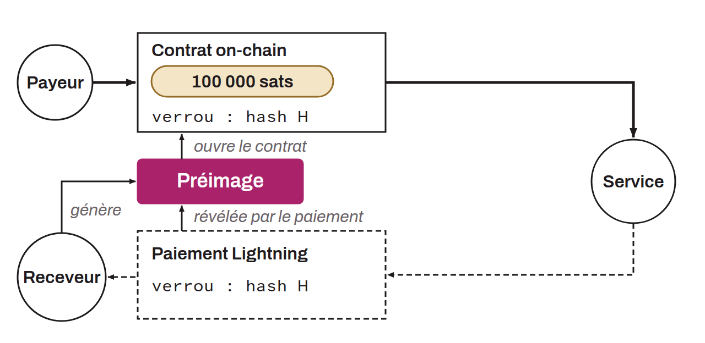

Échange atomique entre des bitcoins on-chain et des bitcoins off-chain sur le Lightning Network, sans risque de contrepartie. Aucune des deux parties ne prend *custody* des fonds de l'autre : soit l'échange réussit intégralement, soit il échoue et chacun récupère ses fonds.

Le mécanisme repose sur les mêmes HTLC (*Hash Time-Locked Contracts*) que ceux utilisés dans le routage Lightning. Le destinataire du paiement Lightning génère une préimage secrète dont le hash sert à construire à la fois un contrat on-chain et un paiement off-chain. Le payeur on-chain verrouille ses bitcoins dans un script conditionnel : les fonds peuvent être réclamés par le prestataire du swap s'il fournit la préimage et sa signature, ou récupérés par le payeur après expiration du *timelock*. Le prestataire paie la facture Lightning du destinataire, et le règlement du paiement lui révèle la préimage, ce qui lui permet de réclamer les fonds on-chain.

