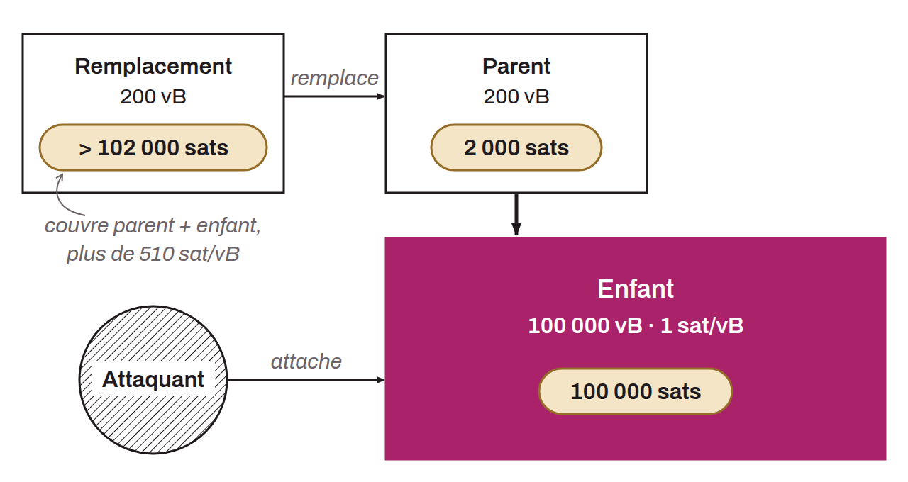

Attaque qui consiste à rendre prohibitivement coûteux le remplacement d'une transaction en exploitant les protections des nœuds contre le gaspillage de bande passante, de CPU et de mémoire. L'attaquant détourne les règles prévues pour empêcher les abus du système de relais et les utilise pour bloquer les tentatives légitimes d'augmentation des frais dans un contexte multipartite.

Deux vecteurs principaux sont exploités. Le premier abuse de la règle 3 du BIP-0125, qui exige que la transaction de remplacement paie des frais absolus supérieurs à ceux de la transaction originale et de tous ses enfants. L'attaquant attache une transaction enfant volumineuse à faible taux de frais, ce qui force la victime à payer des frais démesurément élevés pour effectuer un remplacement par RBF. Le second vecteur exploite les limites de descendants : jusqu'à Bitcoin Core 30, les nœuds restreignent les transactions à 101 000 vbytes de descendants ou 25 ancêtres/descendants au total. Un attaquant peut saturer ces limites avec ses propres transactions enfants, ce qui bloque complètement le CPFP. Depuis Bitcoin Core 31.0 (*cluster mempool*), ces limites sont remplacées par des limites par groupe de transactions liées (*cluster*) : 64 transactions et 101 kvB par défaut. Un remplacement doit aussi, depuis cette version, améliorer strictement le diagramme de taux de frais du mempool.

Cette attaque représente une menace sérieuse pour le Lightning Network et les autres protocoles multipartites, où la gestion des frais est cruciale pour respecter les fenêtres temporelles de règlement. Plusieurs contre-mesures ont été développées : le *CPFP carve-out* (retiré de Bitcoin Core dans la version 31.0), les *ephemeral anchors*, les transactions TRUC (version 3, BIP-0431) et le *package relay*.
