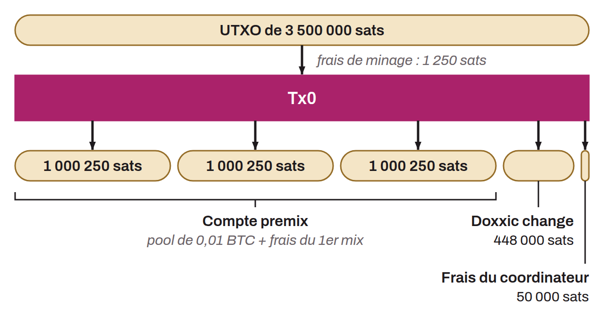

Transaction préparatoire spécifique au protocole Whirlpool, qui constitue la première étape avant les cycles de coinjoin. La Tx0 prend un ou plusieurs UTXOs du portefeuille de l'utilisateur et les restructure en plusieurs outputs calibrés pour correspondre exactement aux montants de la pool de coinjoin choisie, en plus des frais de minage pour le premier cycle.

Concrètement, la Tx0 produit plusieurs types d'outputs : des UTXOs de montant fixe destinés à entrer dans les cycles de coinjoin (qui iront dans le compte premix), un output pour les frais du coordinateur, et éventuellement un output de change (le « *doxxic change* ») qui correspond à l'excédent qui ne peut pas être intégré dans la pool.

