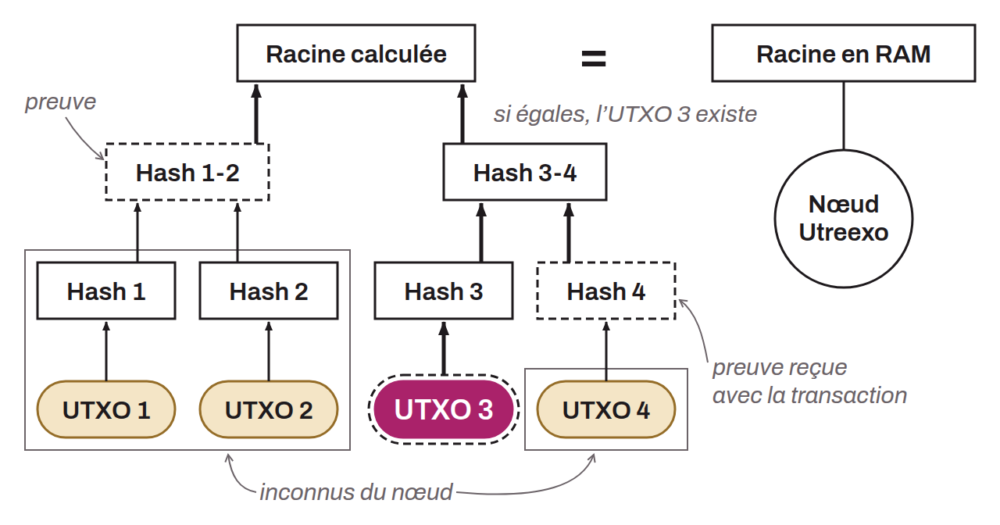

Protocole conçu par Tadge Dryja pour compacter l'UTXO set des nœuds Bitcoin à l'aide d'un accumulateur établi sur des arbres de Merkle. Contrairement à l'UTXO set classique qui nécessite un espace de stockage important, Utreexo réduit drastiquement la mémoire requise en ne stockant que les racines des arbres de Merkle. Cela permet au nœud de vérifier l'existence des UTXOs utilisés en entrées de transactions, sans avoir à conserver l'ensemble complet des UTXOs. En utilisant Utreexo, chaque nœud conserve uniquement des empreintes cryptographiques appelées racines de Merkle. Lorsqu'une transaction est effectuée, l'utilisateur fournit les preuves d'inclusion des UTXOs et les chemins de Merkle correspondants. Le nœud peut ainsi vérifier les transactions sans stocker tout l'UTXO set. Prenons un exemple avec un schéma pour comprendre ce mécanisme :

Dans cet exemple, j'ai intentionnellement réduit l'UTXO set à 4 UTXOs pour faciliter la compréhension. En réalité, il faut imaginer qu'il existe environ 166 millions d'UTXOs sur Bitcoin (chiffre du 26 octobre 2026). Sur ce schéma, le nœud Utreexo devrait uniquement conserver en RAM la Racine de Merkle. S'il reçoit une transaction dépensant l'UTXO n° 3 (la pilule pleine), la preuve consisterait en les éléments suivants :
* L'UTXO 3 ;
* Le HASH 4 ;
* Le HASH 1-2.

Grâce à ces informations transmises par l'émetteur de la transaction, le nœud Utreexo effectue les vérifications suivantes :
* Il calcule l'empreinte de l'UTXO 3, ce qui lui donne HASH 3 ;
* Il concatène HASH 3 avec HASH 4 ;
* Il calcule leur empreinte, ce qui lui donne HASH 3-4 ;
* Il concatène HASH 3-4 avec HASH 1-2 ;
* Il calcule leur empreinte, ce qui lui donne la racine de Merkle.

Si la racine de Merkle qu'il obtient par son processus est la même que la racine de Merkle qu'il stockait dans sa RAM, alors il est persuadé que l'UTXO n° 3 fait bien partie de l'UTXO set.

Cette méthode permet de réduire les besoins en RAM pour les opérateurs de nœuds complets. Cependant, Utreexo présente des limites, notamment l'augmentation des données à transmettre aux nœuds Utreexo en raison des preuves supplémentaires (la taille des blocs au sens du consensus ne change pas) et la dépendance potentielle des nœuds Utreexo envers les *Bridge Nodes* pour obtenir les preuves manquantes. Les *Bridge Nodes* sont des nœuds complets traditionnels qui fournissent les preuves nécessaires aux nœuds Utreexo, permettant ainsi une vérification complète. Cette approche offre un compromis entre efficacité et décentralisation, facilitant l'accès à la validation des transactions pour des utilisateurs aux ressources limitées.
