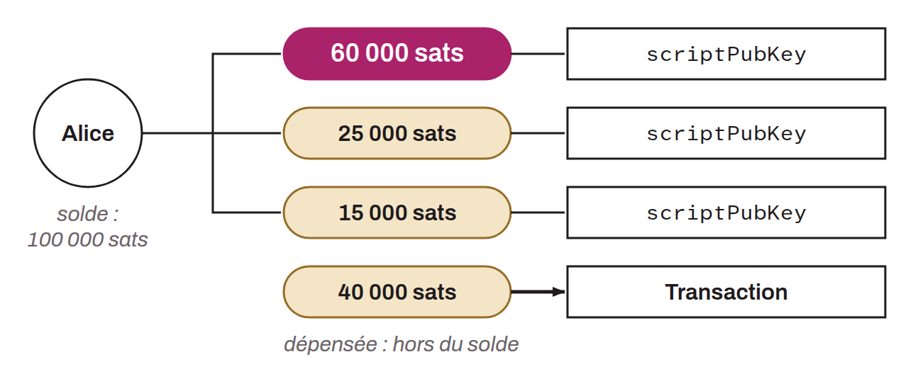

Sigle de *Unspent Transaction Output*. Un UTXO est une sortie de transaction qui n'a pas encore été dépensée, c'est-à-dire utilisée comme entrée pour une nouvelle transaction. Les UTXOs représentent la fraction de bitcoins que possède un utilisateur et qui sont actuellement disponibles pour être dépensés. Chaque UTXO est associé à un script de sortie spécifique (`scriptPubKey`), qui définit les conditions nécessaires pour dépenser les bitcoins. Les transactions dans Bitcoin consomment ces UTXOs en entrées (inputs) et créent de nouveaux UTXOs en sorties (outputs). Le modèle d'UTXO est fondamental sur Bitcoin, car il permet de vérifier facilement que les transactions n'essaient pas de dépenser des bitcoins qui n'existent pas ou qui ont déjà été dépensés.

