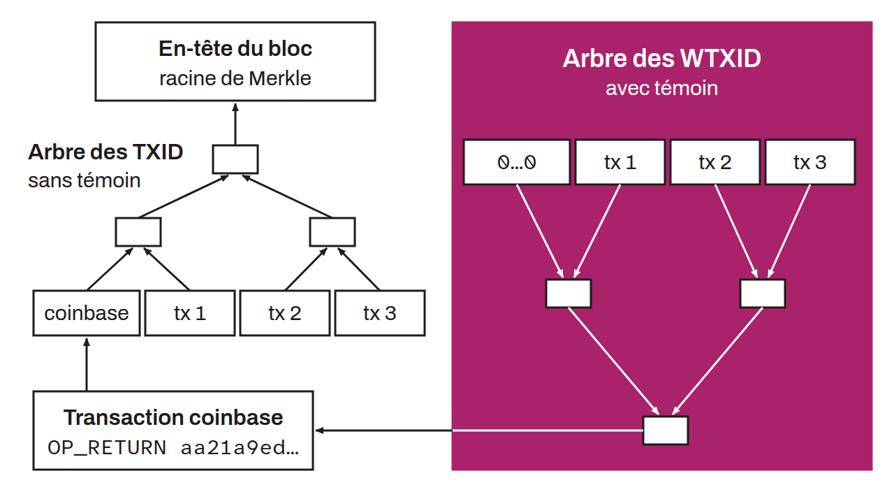

Extension du TXID traditionnel, incluant les données de témoin (*witness*) introduites avec SegWit. Alors que le TXID est un hachage des données de transaction hors témoin, le WTXID est le `SHA256d` de l'intégralité des données de la transaction, témoin inclus. Les WTXID sont stockés dans un second arbre de Merkle dont la racine est mise dans la transaction coinbase. Cette séparation permet de supprimer la malléabilité du TXID de la transaction.

