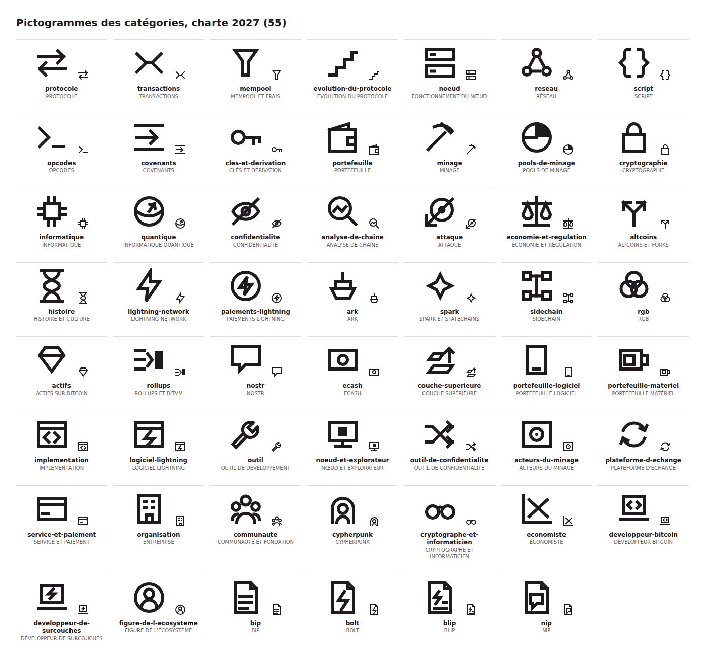

# Pictogrammes des catégories, édition 2027

Les 55 pictogrammes de `templates/parts.yaml` suivent la section 7 de la charte 2027 : grille de 24 × 24, trait de 2 px, extrémités carrées, angles vifs, `stroke-miterlimit` de 4, contours et un aplat au plus, une seule couleur. Chaque slug a deux fichiers dans `assets/pictograms/` : `<slug>.svg` en `currentColor` pour le site et l'ebook, `<slug>.pdf` en noir pour le livre imprimé.

Les huit motifs marqués « planche de la charte » reprennent tels quels les tracés de `design/charte/planche.html`. Leurs pointes et leurs coins débordent un peu de la marge de la grille (encre jusqu'à 1 ou 23, et jusqu'à 0 pour la pointe de l'éclair) ; les trois documents BOLT, BLIP et NIP reprennent le corps du document BIP et en héritent. Les 47 autres restent entre 2 et 22.

| Catégorie | Slug | Motif |
|---|---|---|
| PROTOCOLE | `protocole` | deux flèches opposées |
| TRANSACTIONS | `transactions` | entrées qui convergent, sorties qui divergent |
| MEMPOOL ET FRAIS | `mempool` | entonnoir |
| ÉVOLUTION DU PROTOCOLE | `evolution-du-protocole` | escalier montant |
| FONCTIONNEMENT DU NŒUD | `noeud` | serveur à deux tiroirs |
| RÉSEAU | `reseau` | trois nœuds reliés |
| SCRIPT | `script` | accolades (planche de la charte) |
| OPCODES | `opcodes` | invite de commande |
| COVENANTS | `covenants` | flèche canalisée entre deux rails |
| CLÉS ET DÉRIVATION | `cles-et-derivation` | clé |
| PORTEFEUILLE | `portefeuille` | portefeuille (planche de la charte) |
| MINAGE | `minage` | pioche (planche de la charte) |
| POOLS DE MINAGE | `pools-de-minage` | disque partagé en parts |
| CRYPTOGRAPHIE | `cryptographie` | cadenas (planche de la charte) |
| INFORMATIQUE | `informatique` | puce électronique |
| INFORMATIQUE QUANTIQUE | `quantique` | sphère de Bloch |
| CONFIDENTIALITÉ | `confidentialite` | œil barré |
| ANALYSE DE CHAÎNE | `analyse-de-chaine` | loupe sur un tracé |
| ATTAQUE | `attaque` | cible traversée |
| ÉCONOMIE ET RÉGULATION | `economie-et-regulation` | balance (planche de la charte) |
| ALTCOINS ET FORKS | `altcoins` | fourche |
| HISTOIRE ET CULTURE | `histoire` | sablier (planche de la charte) |
| LIGHTNING NETWORK | `lightning-network` | éclair (planche de la charte) |
| PAIEMENTS LIGHTNING | `paiements-lightning` | pièce frappée d'un éclair |
| ARK | `ark` | arche |
| SPARK ET STATECHAINS | `spark` | étincelle à quatre branches |
| SIDECHAIN | `sidechain` | deux chaînes parallèles reliées |
| RGB | `rgb` | trois anneaux enchaînés |
| ACTIFS SUR BITCOIN | `actifs` | pierre taillée |
| ROLLUPS ET BITVM | `rollups` | trois traits roulés en un bloc |
| NOSTR | `nostr` | bulle de note |
| ECASH | `ecash` | billet |
| COUCHE SUPÉRIEURE | `couche-superieure` | deux plans et une flèche montante |
| PORTEFEUILLE LOGICIEL | `portefeuille-logiciel` | téléphone |
| PORTEFEUILLE MATÉRIEL | `portefeuille-materiel` | clé matérielle à écran |
| IMPLÉMENTATION | `implementation` | fenêtre de logiciel et chevrons |
| LOGICIEL LIGHTNING | `logiciel-lightning` | fenêtre de logiciel et éclair |
| OUTIL DE DÉVELOPPEMENT | `outil` | clé plate |
| NŒUD ET EXPLORATEUR | `noeud-et-explorateur` | écran affichant un bloc |
| OUTIL DE CONFIDENTIALITÉ | `outil-de-confidentialite` | flèches mélangées |
| ACTEURS DU MINAGE | `acteurs-du-minage` | machine à ventilateur |
| PLATEFORME D'ÉCHANGE | `plateforme-d-echange` | deux flèches en cycle |
| SERVICE ET PAIEMENT | `service-et-paiement` | carte de paiement |
| ENTREPRISE | `organisation` | immeuble |
| COMMUNAUTÉ ET FONDATION | `communaute` | trois têtes en arc |
| CYPHERPUNK | `cypherpunk` | tête sous une capuche |
| CRYPTOGRAPHE ET INFORMATICIEN | `cryptographe-et-informaticien` | lunettes rondes |
| ÉCONOMISTE | `economiste` | courbes d'offre et de demande |
| DÉVELOPPEUR BITCOIN | `developpeur-bitcoin` | ordinateur portable et chevrons |
| DÉVELOPPEUR DE SURCOUCHES | `developpeur-de-surcouches` | ordinateur portable et éclair |
| FIGURE DE L'ÉCOSYSTÈME | `figure-de-l-ecosysteme` | portrait en médaillon |
| BIP | `bip` | document à coin plié (planche de la charte) |
| BOLT | `bolt` | document à coin plié et éclair |
| BLIP | `blip` | document à coin plié, petit éclair et lignes |
| NIP | `nip` | document à coin plié et bulle |

Aucun pictogramme de 2026 ne reste sans catégorie : les 55 fichiers du dossier ont tous été redessinés. Plus aucun ne vient de Lucide, d'où le retrait de `LICENSE-lucide.txt`.

